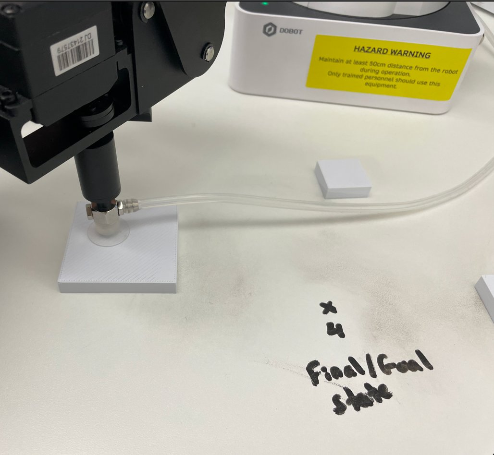
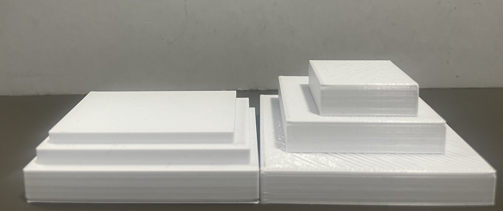
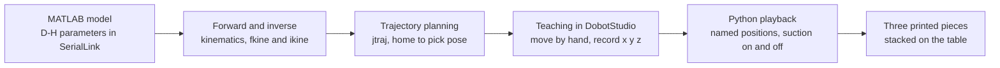
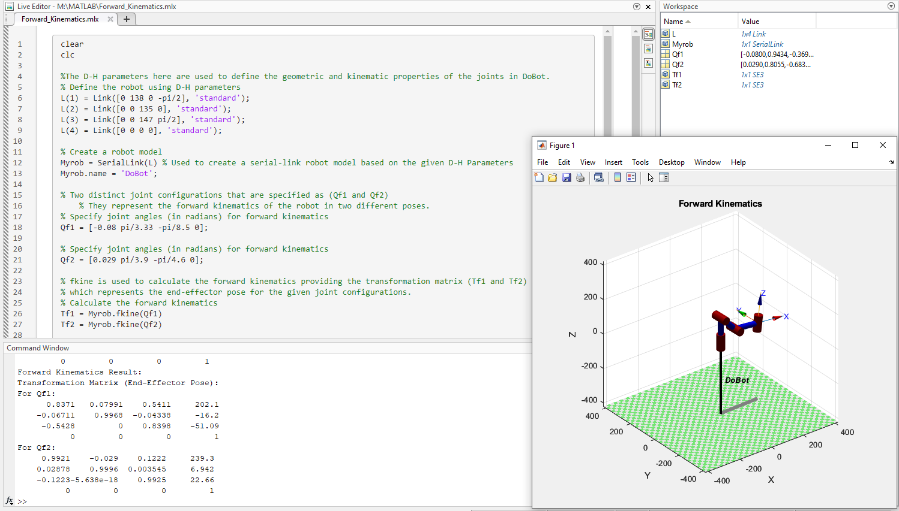
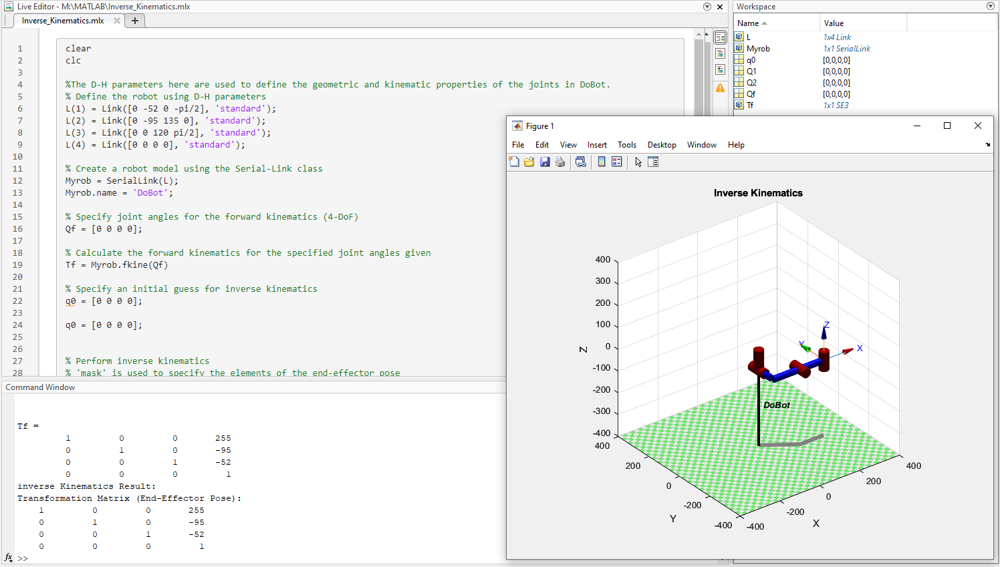
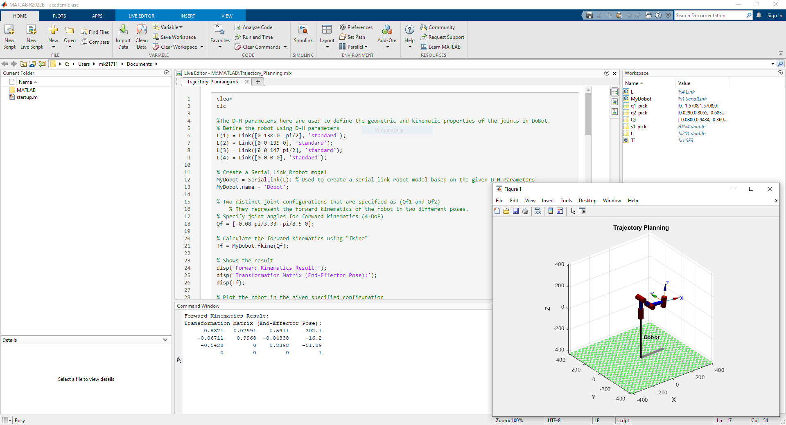
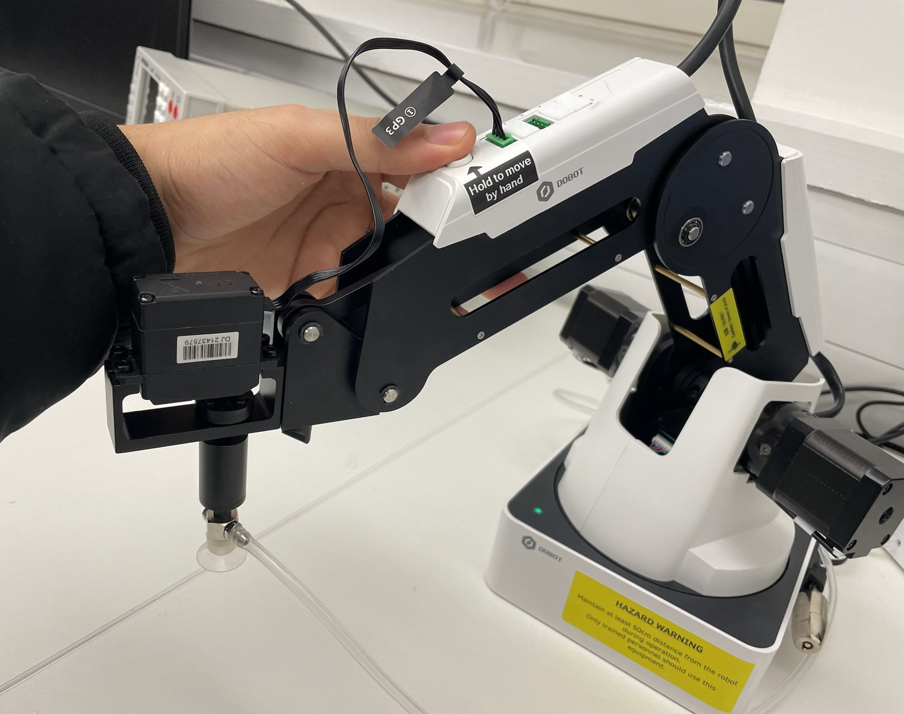
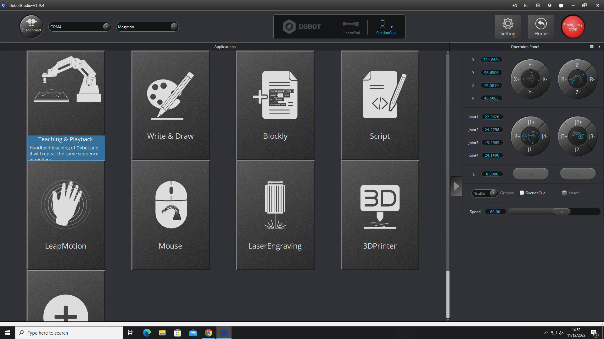
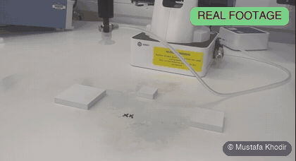
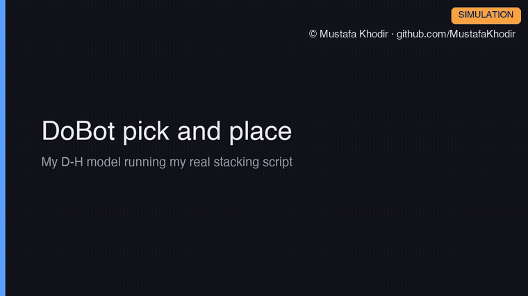

# DoBot Magician Pick and Place Arm

A four axis desktop robot arm that picks up 3D printed pieces with a suction cup and stacks them on top of each other. I modelled the arm's kinematics in MATLAB first, then taught the real DoBot Magician the moves by hand, then wrote a Python script that runs the whole stacking sequence on its own.

## What it does

- Models the DoBot Magician as a four link robot in MATLAB and solves forward kinematics (joint angles in, suction cup position out) and inverse kinematics (target position in, joint angles out).
- Plans a smooth joint space trajectory between the home pose and the pick pose so the arm eases in and out instead of jerking.
- Runs a pick and place routine on the real arm: three 3D printed pieces are picked from the table one at a time and stacked into a tower, using the suction cup.
- The same pieces were designed in TinkerCAD and printed so they would be light enough for the suction cup and flat enough to stack.

## My role

This was a solo build between October and December 2023. I did all of it: the MATLAB model and the three scripts, the TinkerCAD design of the printed pieces, the hand teaching of the arm in DobotStudio, the Python stacking script and all the testing on the real arm.

## How it works

### The arm

The DoBot Magician has four degrees of freedom: base rotation, shoulder, elbow and wrist rotation. The end effector is a vacuum suction cup, fitted 59.7 mm out from the wrist. In the MATLAB model the arm is described with standard Denavit Hartenberg parameters: a 138 mm base, a 135 mm upper arm, a 147 mm forearm and a wrist joint with no offset.

| Joint | Theta | d (mm) | a (mm) | Alpha |
| --- | --- | --- | --- | --- |
| 1, base rotation | variable | 138 | 0 | minus 90 degrees |
| 2, shoulder | variable | 0 | 135 | 0 |
| 3, elbow | variable | 0 | 147 | 90 degrees |
| 4, wrist rotation | variable | 0 | 0 | 0 |

These are the same values used by all three MATLAB scripts.

### From model to real arm

### Forward and inverse kinematics (MATLAB)

Both scripts build the same `SerialLink` model from the four links. Forward kinematics uses `fkine` to turn two sets of measured joint angles into 4 by 4 transforms, and the last column of each transform is the x, y, z position of the suction cup in mm. Those two positions are the pick pose and the drop pose that I then used on the real arm.

Inverse kinematics goes the other way with `ikine`. Because the arm only has four joints it cannot control all six parts of a pose, so the solver is given a mask that asks for x, y, z and one rotation and leaves the other two free. I check the answer by starting from known joint angles, running forward kinematics to get the target, then seeing whether the solver gets back to the same angles.

*Forward kinematics: the transforms for both poses and the arm plotted.*

*Inverse kinematics: the solver recovering the joint angles for a target pose.*

### Trajectory planning (MATLAB)

The trajectory script uses `jtraj` to plan the move from the home pose to the pick pose and back over 10 seconds in 0.05 second steps. `jtraj` gives a smooth velocity profile, so the joints accelerate and decelerate gently. The script animates the arm along the path, draws the line the suction cup traces through space, and plots all four joint angles against time.

*Trajectory planning with jtraj from the home pose to the pick pose.*

### Teaching and playback (DobotStudio)

Before writing any code for the real arm I used the Teaching and Playback app in DobotStudio. The steps were: connect the arm over USB and open Teaching and Playback, press the button on the forearm and move the arm by hand to each position, switch the suction cup on or off at each one, let DobotStudio record the coordinates, then play the sequence back. That gave me a list of real x, y, z coordinates for every pick and drop point.

### Autonomous pick and place (Python)

The Python script runs inside the Script tab of DobotStudio, which supplies the connected `api` object. Every recorded position is named at the top of the script, such as PICK_1, PLACE_1 and LIFT_CLEAR, so the sequence reads like the job it does. It sets the movement speeds and accelerations, tells the arm the suction cup is fitted, then walks through the positions: move above a piece, lower onto it, switch the suction on, lift and carry it over the stack, lower it and switch the suction off. It does that for three pieces, then lifts clear and parks the arm.

### What I found in testing

- The printed pieces could shift by a few millimetres between runs, which was enough to offset the stack. Fixing the pieces in place would make the routine more repeatable.
- The suction tube brushed against the pieces when the wrist rotated while placing, which nudged them. A shorter tube or a different approach angle would solve that.
- The arm reached an elbow singularity in some tests, where the joints line up and the controller loses a direction of movement. I planned the later moves around the arm's limits, which is now something I check first on any arm.

Both the manual teaching and the Python routine completed the stacking task.

## Source code

The source code is private and available on request. Contact me at mkhodir77@gmail.com.

## What's in this repo

- `media/photos/` photos of the arm, the teaching session and the stacked pieces.
- `media/cad/` the three printed pieces as STL files, which GitHub opens in a 3D viewer.
- `media/figures/` the MATLAB plots, the DobotStudio screen and the TinkerCAD design of the pieces.
- `media/demo/` the demo recordings, GIFs to watch here and one MP4 with captions.

## Demo

**The real arm.** The DoBot running the stacking routine on the three printed pieces. Real footage, played at 2.5x.

The same run at normal speed is in the repo as [real-arm-stacking.mp4](media/demo/real-arm-stacking.mp4) (44 s, no sound).

**Pick and place (simulation).** My D-H model of the DoBot running dobot_pick_and_place.py unchanged, one recorded position at a time, with the joint angles solved by inverse kinematics on the model. The table height and suction cup length are worked out from the recorded pick heights.

The full sequence with captions:

https://github.com/user-attachments/assets/05fba164-cdda-47d7-90cd-48cc8ba231ed

The same video is in the repo as [dobot-pick-and-place-sim.mp4](media/demo/dobot-pick-and-place-sim.mp4) (40 s). Background music in the MP4 is a precise sequencer track with servo style ticks, synthesised from scratch for these demos and released as CC0.

The full project report is available on request.

Copyright 2026 Mustafa Khodir. All rights reserved.
